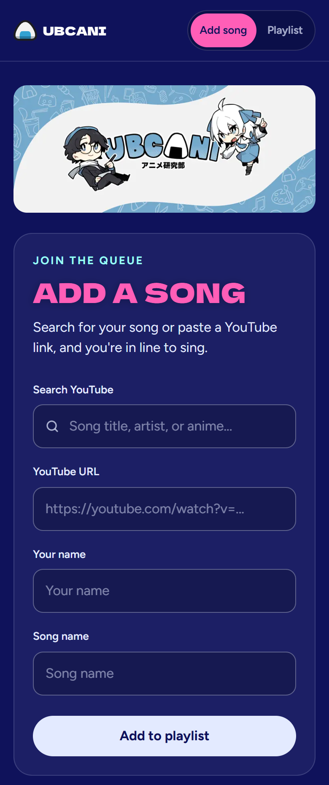
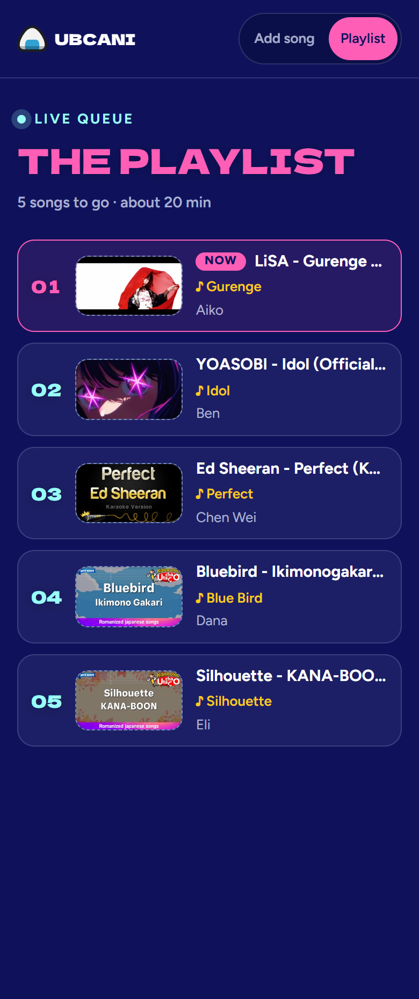
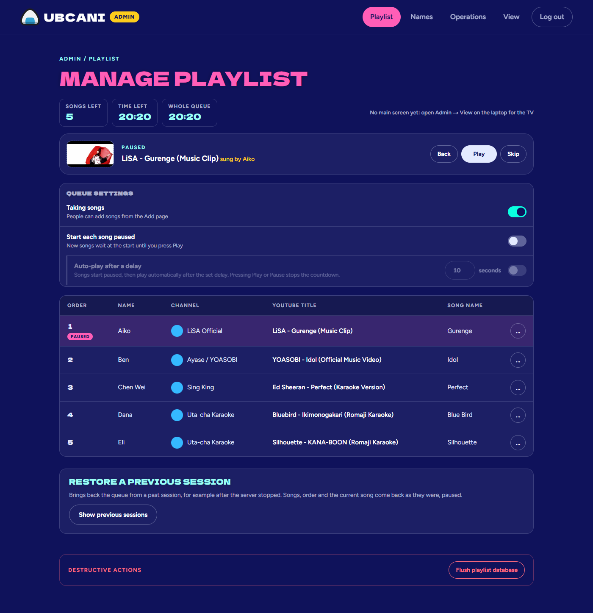
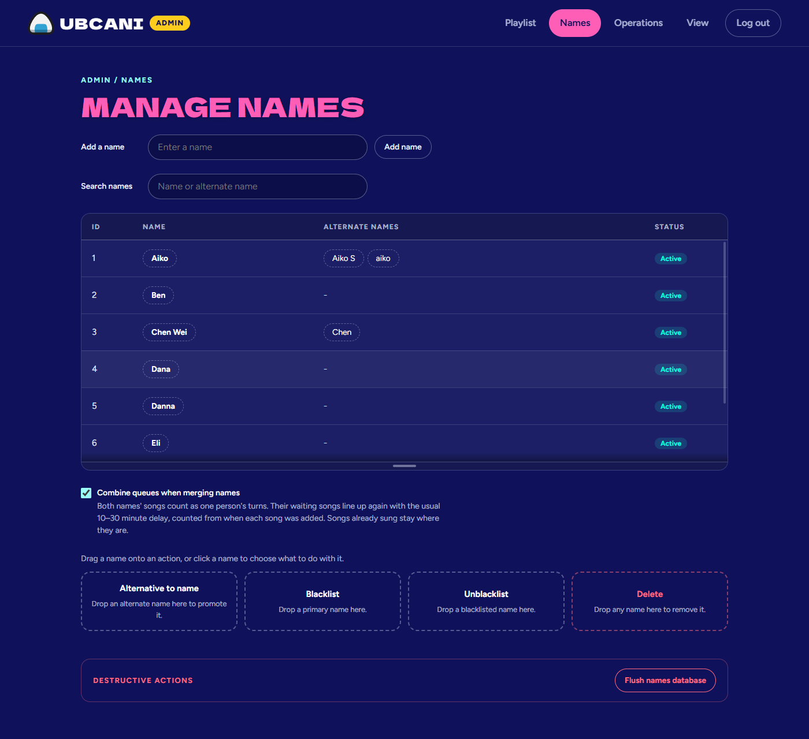
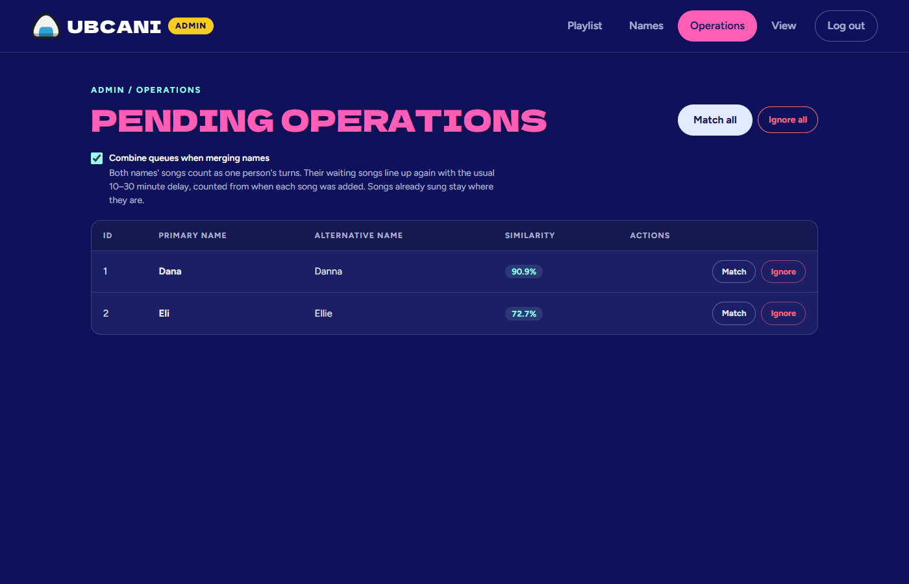
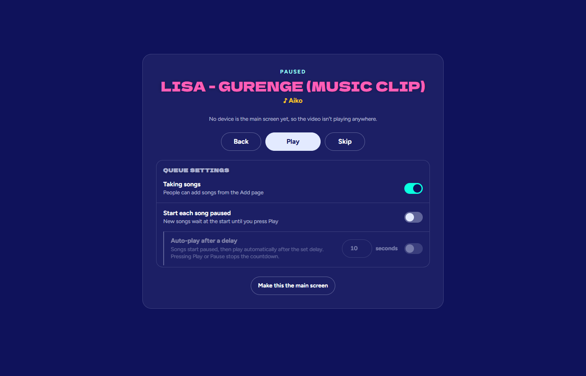

# Karole

The UBCAni karaoke queue. Add YouTube songs from your phone, watch the queue live, and, when
you're hosting, run playback and the queue from the admin pages.

Live at **https://karaoke.ubcani.com**.

## Screenshots

### Singing

Search for a song or paste a YouTube link to join the queue, then follow along on the live playlist.

| Add a song | Live queue |
| :---: | :---: |
|  |  |

### Hosting

Sign in at `/admin/login` to reach the admin pages.

#### Playlist

Play, pause and skip songs, open or close the queue, and reorder or remove songs.



#### Names

Merge alternate spellings into one name, and blacklist names that shouldn't add songs.



#### Operations

Approve or ignore suggested matches for names that look like typos.



#### View

Control the queue from any device that isn't the main screen playing the video.



## What's in here

| Folder | What it is |
| --- | --- |
| `backend/` | FastAPI server (Python) with MongoDB, yt-dlp for YouTube lookups. |
| `frontend/karole-frontend/` | Next.js website: the public pages and the admin pages. |
| `frontend/karole-youtube-extension/` | Browser extension (Chrome, Edge, Brave...) that plays songs in a real YouTube window. |
| `frontend/karole-youtube-extension-firefox/` | The same extension for Firefox. |

## Running it

You need three things running: MongoDB, the backend (port 8000) and the website (port 3000).

```bash
# Backend: copy backend/.env.example to backend/.env and fill it in first
cd backend
python -m venv .venv
.venv/bin/pip install -r requirements.txt
.venv/bin/uvicorn main:app --port 8000

# Website
cd frontend/karole-frontend
npm install
npm run dev
```

Then open http://localhost:3000.

To try the website without MongoDB, run `npm run sample-backend` in `frontend/karole-frontend`
instead of the real backend. It comes with sample songs and names, and the admin password is `karole`.

## More docs

- [Website README](frontend/karole-frontend/README.md): how everything works, restoring a session,
  running on a server, known limits.
- [Extension README](frontend/karole-youtube-extension/README.md): installing and using the
  YouTube window player.
